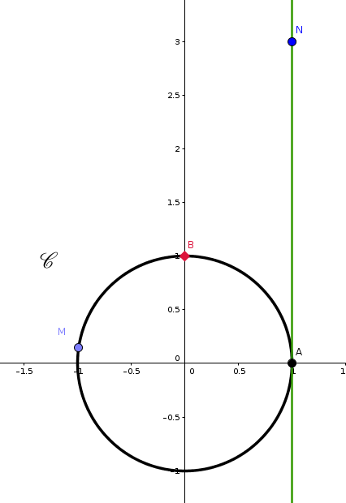
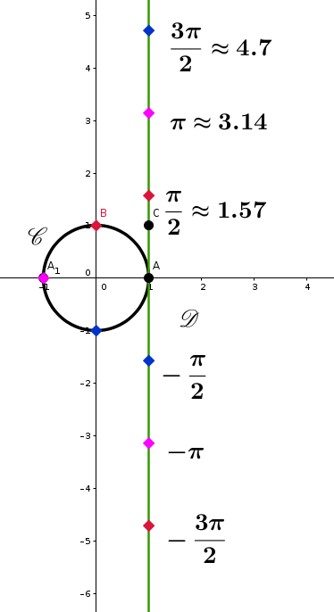
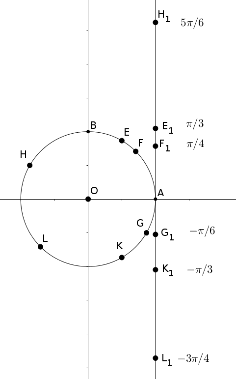
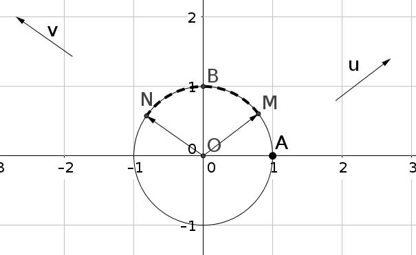
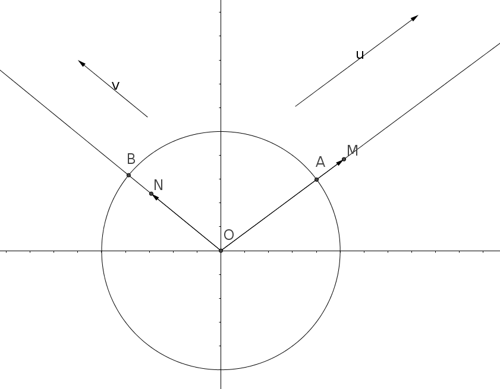
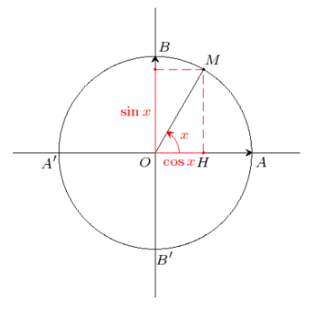
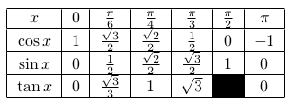
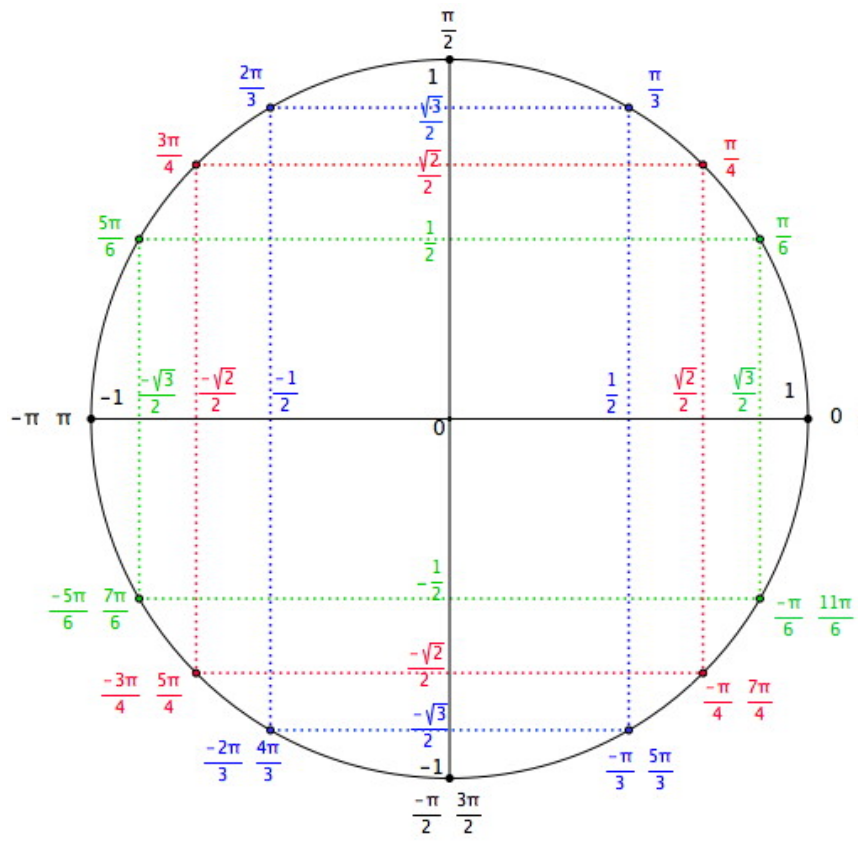
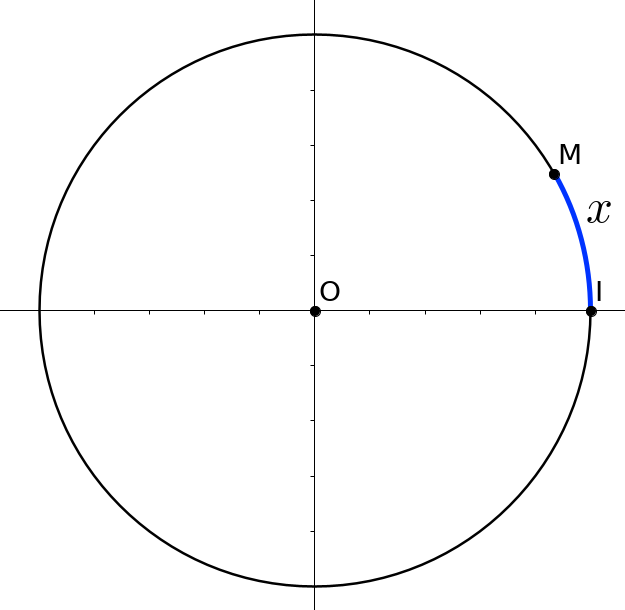

```css
```
```{=html}
<style>
:root {
  --def-color:   #2563eb;
  --prop-color:  #7c3aed;
  --theo-color:  #c026d3;
  --voc-color:   #0d9488;
  --rem-color:   #d97706;
  --ex-color:    #16a34a;
  --app-color:   #ea580c;
  --not-color:   #4f46e5;
  --meth-color:  #dc2626;
  --ill-color:   #475569;
}

.definition, .proposition, .theoreme, .vocabulaire, .remarque, .exemple, .application,
.notation, .methode, .illustration {
  margin: 1.5em 0;
  padding: 1em 1.3em 1em 1.3em;
  border-radius: 10px;
  border-left: 6px solid;
  box-shadow: 0 1px 4px rgba(0,0,0,0.08);
  font-family: "Georgia", serif;
}

.definition::before, .proposition::before, .theoreme::before, .vocabulaire::before,
.remarque::before, .exemple::before, .application::before,
.notation::before, .methode::before, .illustration::before {
  display: block;
  font-family: "Helvetica Neue", Arial, sans-serif;
  font-weight: 700;
  font-size: 0.95em;
  letter-spacing: 0.03em;
  text-transform: uppercase;
  margin-bottom: 0.6em;
}

.definition {
  background: #eff6ff;
  border-color: var(--def-color);
  color: #1e3a5f;
}
.definition::before {
  content: "📘  Définition";
  color: var(--def-color);
}

.proposition {
  background: #f5f3ff;
  border-color: var(--prop-color);
  color: #3b2467;
}
.proposition::before {
  content: "📐  Proposition";
  color: var(--prop-color);
}

.theoreme {
  background: #fdf4ff;
  border-color: var(--theo-color);
  color: #701a75;
}
.theoreme::before {
  content: "🏛️  Théorème";
  color: var(--theo-color);
}

.vocabulaire {
  background: #f0fdfa;
  border-color: var(--voc-color);
  color: #0f4c46;
}
.vocabulaire::before {
  content: "🏷️  Vocabulaire";
  color: var(--voc-color);
}

.remarque {
  background: #fffbeb;
  border-color: var(--rem-color);
  color: #6b4a06;
}
.remarque::before {
  content: "💡  Remarque";
  color: var(--rem-color);
}

.exemple {
  background: #f0fdf4;
  border-color: var(--ex-color);
  color: #14532d;
}
.exemple::before {
  content: "🔍  Exemple";
  color: var(--ex-color);
}

.application {
  background: #fff7ed;
  border: 2px dashed var(--app-color);
  border-left: 6px solid var(--app-color);
  color: #7c2d12;
}
.application::before {
  content: "✏️  Application";
  color: var(--app-color);
  font-size: 1.05em;
}

.notation {
  background: #eef2ff;
  border-color: var(--not-color);
  color: #312e81;
}
.notation::before {
  content: "🖊️  Notation";
  color: var(--not-color);
}

.methode {
  background: #fef2f2;
  border-color: var(--meth-color);
  color: #7f1d1d;
}
.methode::before {
  content: "🧭  Méthode";
  color: var(--meth-color);
}

.illustration {
  background: #f8fafc;
  border-color: var(--ill-color);
  color: #1e293b;
}
.illustration::before {
  content: "🖼️  Illustration";
  color: var(--ill-color);
}

/* Callouts "Solution" un peu plus stylés */
div.callout-caution {
  border-radius: 10px;
  box-shadow: 0 1px 4px rgba(0,0,0,0.08);
}
div.callout-caution .callout-title {
  font-family: "Helvetica Neue", Arial, sans-serif;
  font-weight: 700;
}
div.callout-caution .callout-title::before {
  content: "🔓  ";
}
</style>
```

# Angles orientés de vecteurs

## Cercle trigonométrique, mesures d'arcs orientés

::: {.definition}
On appelle cercle trigonométrique un cercle de centre $O$ de rayon 1, orienté dans le sens direct.
:::

::: {.remarque}
Par convention, le sens direct (noté +) est le sens inverse de celui des aiguilles d'une montre.
:::

#### Enroulement de la droite des réels :

Dans le plan muni d'un repère orthonormal $(O,A,B)$, on considère le cercle trigonométrique $C$.\
Soit $P$ le point tel que $\overrightarrow{AP}=\overrightarrow{OB}$ et soit $d$ la droite orientée, perpendiculaire à l'axe des abscisses, qui passe par $A$, munie du repère $(A,P)$.\
En enroulant cette droite $d$ autour du cercle $C$, on obtient une correspondance entre un point $N$ de la droite et un point $M$ du cercle.

::: {.definition}
Soit $C$ le cercle trigonométrique et $M$ un point de ce cercle.\
La mesure en radian de l'angle $\widehat{AOM}$ est la longueur de l'arc $\overset{\frown}{AM}$ intercepté par cet angle.\
Le symbole associé à cette mesure est rad.
:::

::: {.exemple}
Sur le schéma ci-contre, le point $N$ de coordonnée 3 sur la droite $d$, se retrouve après enroulement de $d$ sur $C$ en $M$ tel que la longueur de l'arc $\overset{\frown}{AM}$ est égale à $AN$.

{width="55%" fig-align="center"}
:::

::: {.remarque}
-   Comme le cercle trigonométrique est de rayon 1, son périmètre est de longueur $2\pi$.

-   Le point de $d$ de coordonnée $2\pi$ se retrouve ainsi en $A$.\
    Cela correspond à un tour complet, soit un angle de 360°.

Par proportionnalité entre angle et arc intercepté, on obtient les correspondances suivantes :

|     Coordonnée de $N$ sur $d$     | $-\dfrac{\pi}{2}$ |  0  | $\dfrac{\pi}{2}$ | $\pi$ | $2\pi$ |
|:---------------------------------:|:-----------------:|:---:|:----------------:|:-----:|:------:|
| Mesure de l'angle $\widehat{AOM}$ |                   |     |                  |       |        |
:::

::: {.callout-caution collapse="true"}
## Solution

|     Coordonnée de $N$ sur $d$     | $-\dfrac{\pi}{2}$ |      0      | $\dfrac{\pi}{2}$ |     $\pi$     |    $2\pi$     |
|:---------------------------------:|:-----------------:|:-----------:|:----------------:|:-------------:|:-------------:|
| Mesure de l'angle $\widehat{AOM}$ |   $-90^{\circ}$   | $0^{\circ}$ |   $90^{\circ}$   | $180^{\circ}$ | $360^{\circ}$ |
:::

::: {.remarque}
Plusieurs points de la droite $d$ correspondent à un même point du cercle $C$ car la droite peut s'enrouler plusieurs fois.

Par exemple :

-   Les points de $d$ de coordonnée $\dfrac{\pi}{3}$ et $\dfrac{7\pi}{3}$ correspondent tous les deux à un même point sur $C$.

-   Les points de $d$ de coordonnée $-\dfrac{\pi}{2}$ et $\dfrac{3\pi}{2}$ correspondent tous les deux à un même point sur $C$.

{width="65%" fig-align="center"}
:::

::: {.proposition}
Soient $A$ et $M$ deux points du cercle trigonométrique.\
Si $\ell$ est une mesure de l'arc orienté $\overset{\frown}{AM}$, alors toutes les mesures de cet arc sont de la forme $\ell+2k \pi$, où $k\in \mathbb{Z}$.\
On note alors $\overset{\frown}{AM}=\ell+2k\pi$ $(k\in \mathbb{Z})$ ou $\overset{\frown}{AM}=\ell\,[2 \pi]$.\
La deuxième notation se lit « $\ell$ modulo $2\pi$ ».
:::

::: {.exemple}
{width="65%" fig-align="center"}

-   $\overset{\frown}{AE}=\dfrac{\pi}{3}[2\pi]$;

-   $\overset{\frown}{AF}=\dfrac{\pi}{4}[2\pi]$;

-   $\overset{\frown}{AG}=-\dfrac{\pi}{6}[2\pi]$;

-   $\overset{\frown}{AH}=\dfrac{5\pi}{6}[2\pi]$;

-   $\overset{\frown}{AK}=-\dfrac{\pi}{3}[2\pi]$;

-   $\overset{\frown}{AL}=-\dfrac{3\pi}{4}[2\pi]$.
:::

## Angles orientés de vecteurs 

::: {.definition}
Soient $\overrightarrow{u}$ et $\overrightarrow{v}$ deux vecteurs unitaires ($\lVert\overrightarrow{u}\rVert=\lVert\overrightarrow{v}\rVert=1$).\
Il existe deux points $M$ et $N$ du cercle trigonométrique tels que $\overrightarrow{OM}=\overrightarrow{u}$ et $\overrightarrow{ON}=\overrightarrow{v}$.\
On appelle mesure de l'angle orienté de vecteurs $(\overrightarrow{u},\overrightarrow{v})$ toute mesure de l'arc orienté $\overset{\frown}{MN}$.
:::

::: {.illustration}
{width="60%" fig-align="center"}
:::

::: {.definition}
Soient $\overrightarrow{u}$ et $\overrightarrow{v}$ deux vecteurs non nuls. On note $C$ le cercle trigonométrique de centre $O$.\
On pose $\overrightarrow{u}=\overrightarrow{OM}$ et $\overrightarrow{v}=\overrightarrow{ON}$.\
Les demi-droites $[OM)$ et $[ON)$ coupent respectivement le cercle trigonométrique $C$ en $A$ et $B$.\
Les vecteurs $\overrightarrow{OA}$ et $\overrightarrow{OB}$ sont unitaires et respectivement de même direction et de même sens que $\overrightarrow{u}$ et $\overrightarrow{v}$.\
On appelle alors mesure de l'angle orienté $(\overrightarrow{u},\overrightarrow{v})$, toute mesure de l'angle orienté $(\overrightarrow{OA},\overrightarrow{OB})$.
:::

::: {.illustration}
{width="60%" fig-align="center"}
:::

::: {.definition}
Une seule mesure de l'angle orienté $(\overrightarrow{u},\overrightarrow{v})$ appartient à l'intervalle $]-\pi;\pi]$. Cette mesure est appelée mesure principale de l'angle $(\overrightarrow{u},\overrightarrow{v})$.
:::

::: {.application}
Trouver la mesure principale d'un angle orienté dont une mesure est $\dfrac{17\pi}{3}$.
:::

::: {.callout-caution collapse="true"}
## Solution

Deux méthodes pour déterminer la mesure principale d'un angle :

On sait que la mesure principale est de la forme $\dfrac{17\pi}{3} +2k\pi$ et qu'elle doit être dans l'intervalle $]-\pi;\pi]$. On a donc :

$$\begin{aligned}
 -\pi &< \dfrac{17\pi}{3} +2k\pi \leqslant\pi \\
 -1 &< \dfrac{17}{3}+2k \leqslant 1 \\
 -1-\dfrac{17}{3} &< 2k \leqslant 1-\dfrac{17}{3} \\
 -\dfrac{20}{3} &< 2k \leqslant-\dfrac{14}{3} \\
 -\dfrac{10}{3} &< k \leqslant-\dfrac{7}{3}
\end{aligned}$$ Or on sait que $k\in \mathbb{Z}$ et que $-\dfrac{10}{3} \approx -3{,}3$ et $-\dfrac{7}{3} \approx -2{,}3$ donc nécessairement $k=-3$.\
La mesure principale de l'angle est donc $\dfrac{17\pi}{3}+2\times (-3)\pi=\dfrac{17\pi}{3} -6 \pi=\dfrac{17\pi - 18 \pi}{3}=-\dfrac{\pi}{3}$.

On décompose $\dfrac{17\pi}{3}$ afin de faire apparaître le nombre de tours « en trop » :

$$\begin{aligned}
    \dfrac{17\pi}{3}&=\dfrac{(3\times 6 -1)\pi}{3} \\
    &=\dfrac{3\times 6}{3} \pi -\dfrac{1}{3}\pi \\
    &= 6\pi - \dfrac{1}{3} \pi \\
    &= 3\times 2\pi - \dfrac{\pi}{3}
\end{aligned}$$ Ainsi $\dfrac{17\pi}{3}=-\dfrac{\pi}{3} [2\pi]$.\
Or $-\dfrac{\pi}{3}\in\,]-\pi;\pi]$, donc la mesure principale est $-\dfrac{\pi}{3}$.
:::

# Trigonométrie

## Cosinus et sinus

::: {.definition}
On dit qu'un repère $(O;\overrightarrow{i},\overrightarrow{j})$ du plan orienté est orthonormal direct si :

$\lVert\overrightarrow{i}\rVert=\lVert\overrightarrow{j}\rVert=1$ et $(\overrightarrow{i},\overrightarrow{j})=+\dfrac{\pi}{2}[2\pi]$
:::

::: {.definition}
Soient $C$ le cercle trigonométrique de centre $O$ et $A$ et $B$ deux points du cercle $C$ tels que le repère $(O;\overrightarrow{OA},\overrightarrow{OB})$ soit orthonormal direct.\
Soit $x$ un réel.\
Il existe un unique point $M$ du cercle trigonométrique $C$ tel que $(\overrightarrow{OA},\overrightarrow{OM})=x[2\pi]$.\
On appelle cosinus et sinus de $x$ (notés $\cos(x)$ et $\sin(x)$) les coordonnées du point $M$ dans le repère $(O;\overrightarrow{OA},\overrightarrow{OB})$.

-   $\cos(x)$ : abscisse du point $M$.

-   $\sin(x)$ : ordonnée du point $M$.
:::

::: {.illustration}
{width="60%" fig-align="center"}
:::

::: {.remarque}
**Lien avec le triangle rectangle**
Soit $x\in\left]0;\dfrac{\pi}{2}\right[$ et $M$ le point du cercle trigonométrique associé à $x$. On note $H$ le projeté orthogonal de $M$ sur l'axe des abscisses.

Le triangle $OHM$ est rectangle en $H$, d'hypoténuse $OM=1$ et $\widehat{HOM}=x$. Donc : $$\cos(x)=\dfrac{OH}{OM}=OH \qquad \text{et} \qquad \sin(x)=\dfrac{HM}{OM}=HM.$$ On retrouve les définitions du cosinus et du sinus vues au collège : le cosinus et le sinus d'un réel prolongent celles-ci.

{width="70%" fig-align="center"}
:::

## Résultats à retenir

::: {.proposition}
Pour tout $x\in \mathbb{R}$ et pour tout $k\in\mathbb{Z}$ :

-   $\cos(x+2k\pi)=\cos(x)$

-   $\sin(x+2k\pi)=\sin(x)$

-   $\cos^2(x)+\sin^2(x)=1$

-   $-1 \leqslant\cos(x) \leqslant 1$

-   $-1 \leqslant\sin(x) \leqslant 1$

On rappelle que si $\cos(x)\neq0$, alors : $$\tan(x)=\dfrac{\sin(x)}{\cos(x)}.$$ Quelques valeurs de cosinus, sinus et tangente sont à retenir (tableau ci-dessous).

{width="65%" fig-align="center"}
:::

::: {.callout-caution collapse="true"}
## Solution

Démonstration de $\cos\left(\frac{\pi}{4}\right)$, $\sin\left(\frac{\pi}{4}\right)$, $\cos\left(\frac{\pi}{3}\right)$ et $\sin\left(\frac{\pi}{3}\right)$ :\
Dans les deux cas, on note $M$ le point du cercle trigonométrique associé au réel considéré et $H$ le projeté orthogonal de $M$ sur l'axe des abscisses. Le triangle $OHM$ est rectangle en $H$ et $OM=1$.

**Cas de $\dfrac{\pi}{4}$.** L'angle $\widehat{HOM}$ mesure $\dfrac{\pi}{4}$ rad, soit $45^{\circ}$. Le triangle $OHM$, rectangle en $H$, a donc deux angles de $45^{\circ}$ : il est isocèle en $H$ et $OH=HM$.\
D'après le théorème de Pythagore, $OH^2+HM^2=OM^2$, donc $2\,OH^2=1$, soit $OH^2=\dfrac{1}{2}$.\
Comme $OH>0$, $OH=\dfrac{1}{\sqrt{2}}=\dfrac{\sqrt{2}}{2}$.\
Ainsi $\cos\left(\dfrac{\pi}{4}\right)=\sin\left(\dfrac{\pi}{4}\right)=\dfrac{\sqrt{2}}{2}$.

**Cas de $\dfrac{\pi}{3}$.** Le triangle $OAM$ est isocèle en $O$ (car $OA=OM=1$) et $\widehat{AOM}$ mesure $\dfrac{\pi}{3}$ rad, soit $60^{\circ}$. Ses deux autres angles mesurent donc aussi $60^{\circ}$ : il est équilatéral.\
La hauteur $[MH]$ est aussi une médiane, donc $H$ est le milieu de $[OA]$ et $OH=\dfrac{1}{2}$, d'où $\cos\left(\dfrac{\pi}{3}\right)=\dfrac{1}{2}$.\
D'après le théorème de Pythagore, $HM^2=OM^2-OH^2=1-\dfrac{1}{4}=\dfrac{3}{4}$. Comme $HM>0$, $HM=\dfrac{\sqrt{3}}{2}$, d'où $\sin\left(\dfrac{\pi}{3}\right)=\dfrac{\sqrt{3}}{2}$.
:::

::: {.remarque}
Pour retenir tous les résultats de ce tableau, on peut s'aider du cercle trigonométrique :

{width="65%" fig-align="center"}
:::

::: {.application}
Calculer $\sin(\alpha)$ et $\cos(\beta)$ sachant que :

-   $\cos(\alpha)=0{,}6$ et $-\frac{\pi}{2}<\alpha<0$ ;

-   $\sin(\beta)=0{,}8$ et $\frac{\pi}{2}<\beta<\pi$.
:::

::: {.callout-caution collapse="true"}
## Solution

$$\begin{aligned}
 \cos^2(\alpha)+\sin^2(\alpha)&=1 \\
 0{,}6^2+\sin^2(\alpha)&=1 \\
 \sin^2(\alpha)&=1-0{,}6^2\\
 \sin^2(\alpha)&=0{,}64
\end{aligned}$$ Donc $\sin(\alpha)=0{,}8$ ou $\sin(\alpha)=-0{,}8$.\
Or $\alpha\in\left]-\tfrac{\pi}{2};0\right[$, donc $\sin(\alpha)<0$.\
Ainsi $\sin(\alpha)=-0{,}8$.

$$\begin{aligned}
  \cos^2(\beta)+\sin^2(\beta)&=1 \\
  \cos^2(\beta)+0{,}8^2&=1 \\
  \cos^2(\beta)&=1-0{,}64\\
  \cos^2(\beta)&=0{,}36
\end{aligned}$$ Donc $\cos(\beta)=0{,}6$ ou $\cos(\beta)=-0{,}6$.\
Or $\beta\in\left]\tfrac{\pi}{2};\pi\right[$, donc $\cos(\beta)<0$.\
Ainsi $\cos(\beta)=-0{,}6$.
:::

::: {.application}
Déterminer la valeur exacte de $A=\cos \left(\dfrac{13\pi}{2}\right) + \sin \left(\dfrac{19\pi}{3}\right)$.
:::

::: {.callout-caution collapse="true"}
## Solution

$\dfrac{13\pi}{2}=\dfrac{\pi}{2}+6\pi=\dfrac{\pi}{2}+3\times 2\pi$, donc $\cos \left(\dfrac{13\pi}{2}\right)=\cos \left(\dfrac{\pi}{2}\right)=0$.

$\dfrac{19\pi}{3}=\dfrac{\pi}{3}+6\pi=\dfrac{\pi}{3}+3\times 2\pi$, donc $\sin \left(\dfrac{19\pi}{3}\right)=\sin \left(\dfrac{\pi}{3}\right)=\dfrac{\sqrt{3}}{2}$.

Ainsi $A=0+\dfrac{\sqrt{3}}{2}=\dfrac{\sqrt{3}}{2}$.
:::

## Angles associés

Dans toute cette partie, $x$ désigne un réel et $M$ le point associé au réel $x$ sur le cercle trigonométrique.

### Cosinus et sinus de $-x$

::: {.proposition}

$\cos(-x)=\cos(x)$\
$\sin(-x)=-\sin(x)$

{width="45%" fig-align="center"}
:::

### Cosinus et sinus de $\pi-x$

::: {.proposition}

$\cos(\pi-x)=-\cos(x)$\
$\sin(\pi-x)=\sin(x)$

{width="45%" fig-align="center"}
:::

### Cosinus et sinus de $\pi+x$

::: {.proposition}

$\cos(\pi+x)=-\cos(x)$\
$\sin(\pi+x)=-\sin(x)$

{width="45%" fig-align="center"}
:::

### Cosinus et sinus de $\dfrac{\pi}{2}-x$

::: {.proposition}

$\cos\left(\dfrac{\pi}{2}-x\right)=\sin(x)$\
$\sin\left(\dfrac{\pi}{2}-x\right)=\cos(x)$

{width="45%" fig-align="center"}
:::

### Cosinus et sinus de $\dfrac{\pi}{2}+x$

::: {.proposition}

$\cos\left(\dfrac{\pi}{2}+x\right)=-\sin(x)$\
$\sin\left(\dfrac{\pi}{2}+x\right)=\cos(x)$

{width="45%" fig-align="center"}
:::

### Exemples

$$\begin{aligned}
\cos\left(\dfrac{2\pi}{3} \right)&=\cos\left(\pi-\dfrac{\pi}{3} \right)\\
&=-\cos\left(\dfrac{\pi}{3} \right)=-\dfrac{1}{2}\\[2mm]
\cos\left(\dfrac{7\pi}{6} \right)&=\cos\left(\pi+\dfrac{\pi}{6} \right)\\
&=-\cos\left(\dfrac{\pi}{6} \right)=-\dfrac{\sqrt{3}}{2}\\[2mm]
\sin \left( -\dfrac{\pi}{4} \right)&=-\sin \left( \dfrac{\pi}{4} \right) = -\dfrac{\sqrt{2}}{2}
\end{aligned}$$

## Résolution d'équations trigonométriques

::: {.proposition}
Soient $a$ et $b$ des réels.

$\cos (a) = \cos (b) \Longleftrightarrow \left\lbrace \begin{array}{l}
b= a + 2k\pi, \quad k \in \mathbb{Z}\\ \qquad \text{ou} \\ b = -a + 2k\pi, \quad k \in \mathbb{Z}
\end{array} \right.$

$\sin (a) = \sin (b) \Longleftrightarrow \left\lbrace \begin{array}{l}
b= a + 2k\pi, \quad k \in \mathbb{Z}\\ \qquad \text{ou} \\ b = \pi-a + 2k\pi, \quad k \in \mathbb{Z}
\end{array} \right.$
:::

::: {.application}
Résoudre dans $\mathbb{R}$ l'équation $\cos(2x)=\cos\left(x-\dfrac{\pi}{3}\right)$.
:::

::: {.callout-caution collapse="true"}
## Solution

Soit $k\in\mathbb{Z}$. $$\begin{aligned}
\cos(2x)=\cos\left(x-\dfrac{\pi}{3}\right) &\Leftrightarrow 2x=x-\dfrac{\pi}{3}+2k\pi \quad \text{ ou } \quad 2x=-\left(x-\dfrac{\pi}{3}\right)+2k\pi \\
&\Leftrightarrow  x=-\dfrac{\pi}{3}+2k\pi \quad \text{ ou } \quad 3x = \dfrac{\pi}{3}+2k\pi \\
&\Leftrightarrow  x=-\dfrac{\pi}{3}+2k\pi \quad \text{ ou } \quad x= \dfrac{\pi}{9}+\dfrac{2k\pi}{3}
\end{aligned}$$ $S=\left\{ -\dfrac{\pi}{3}+2k\pi,\ k \in \mathbb{Z}\right\} \cup \left\{ \dfrac{\pi}{9}+\dfrac{2k\pi}{3},\ k \in \mathbb{Z}\right\}$.
:::

::: {.application}
Résoudre dans $\mathbb{R}$ l'équation $\sin(3x)=\sin\left(2x-\dfrac{\pi}{4} \right)$.
:::

::: {.callout-caution collapse="true"}
## Solution

Soit $k\in\mathbb{Z}$. $$\begin{aligned}
\sin(3x)=\sin\left(2x-\dfrac{\pi}{4} \right) &\Leftrightarrow 3x=2x-\dfrac{\pi}{4}+2k\pi \quad \text{ ou } \quad 3x=\pi-\left(2x-\dfrac{\pi}{4}\right)+2k\pi \\
&\Leftrightarrow x=-\dfrac{\pi}{4} +2k\pi \quad \text{ ou } \quad 5x= \dfrac{5\pi}{4} +2k\pi \\
&\Leftrightarrow x=-\dfrac{\pi}{4} +2k\pi \quad \text{ ou } \quad x=\dfrac{\pi}{4}+\dfrac{2k\pi}{5}
\end{aligned}$$ $S= \left\{ -\dfrac{\pi}{4} +2k\pi,\ k \in \mathbb{Z}\right\} \cup \left\{ \dfrac{\pi}{4}+\dfrac{2k\pi}{5},\ k \in \mathbb{Z}\right\}$.
:::
